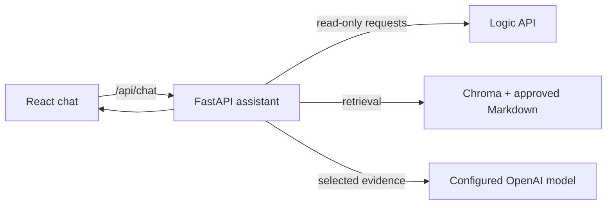

# Logic Escape Room — AI Conversational Assistant

Repository documentation for the PFM prototype.

## Development order

1. `docs/01_PHASE_BOOTSTRAP.md`
2. `docs/02_PHASE_LOGIC_API.md`
3. `docs/03_PHASE_RAG.md`
4. `docs/04_PHASE_ORCHESTRATION.md`
5. `docs/05_PHASE_FRONTEND.md`
6. `docs/06_PHASE_EVALUATION.md`
7. `docs/07_PHASE_HARDENING.md`

Read `AGENTS.md` before implementing anything.

## Architecture summary

- **Logic API**: source of truth for structured operational data.
- **RAG**: contextual policies, exceptions and non-structured knowledge.
- **LLM**: interpretation and natural-language generation.
- **Human fallback**: when evidence is insufficient.



The browser talks only to the assistant backend. The backend validates a bounded route, reads structured facts from Logic API and policies from RAG, and asks the configured model to phrase an answer from that evidence. The MVP does not create bookings.

### Cache

Cache with configurable TTL:

- rooms;
- rates;
- opening hours.

Do not cache:

- availability;
- specific quotes.

## MVP boundary

The first MVP does not create reservations.

See `docs/USER_SETUP_CHECKLIST.md` for the project-owner tasks.

## Evaluation and delivery

The 40-case dataset and repeatable runner are documented in [`evaluation/README.md`](evaluation/README.md). Preserved evaluation results are under `evaluation/results/`; [`release_manifest.json`](evaluation/results/release_manifest.json) identifies the latest recorded run and explains which version it covers. The automated route and source scores are not a substitute for manual answer-quality review.

The prototype is not production-ready: the Logic API has no server authentication, and this service has no user authentication or rate limiting. Chat messages and recent context are sent to the configured model provider; complete the privacy and retention review before using real customer conversations. See [`docs/07_PHASE_HARDENING.md`](docs/07_PHASE_HARDENING.md) for the security findings, deployment gaps and release checklist.

## Runtime configuration and dependencies

Configure secrets and operational values in a local, ignored `.env` using [`.env.example`](.env.example) as a template. The backend uses `OPENAI_API_KEY`, `OPENAI_MODEL`, optional model/timeout settings, `LOGIC_API_BASE_URL`, and the verified business settings documented in [`docs/08_ENVIRONMENT_AND_COMMANDS.md`](docs/08_ENVIRONMENT_AND_COMMANDS.md). Never expose `.env` values to the browser or commit them.

The backend dependency list is in `backend/pyproject.toml`; the React/Vite dependency list is in `frontend/package.json`. There is no production deployment or third-party vulnerability audit recorded for this prototype.

Logic API is an external runtime dependency configured with `LOGIC_API_BASE_URL`. The assistant uses only `GET /api/rates`, `GET /api/bookings/quote`, `GET /api/rooms`, `GET /api/bookings/opening-hours` and `GET /api/bookings/availability`. It does not call booking-list, booking-detail, booking-consult or booking-write operations. Approved RAG material and its category/dependency inventory are listed in [`knowledge/INDEX.md`](knowledge/INDEX.md); structured prices, active rooms and live availability remain API-owned.

## Conocimiento y políticas de Nox

El corpus documental, su índice y el pipeline de ingesta/búsqueda están en [`knowledge/`](knowledge/INDEX.md) y `backend/app/rag/`. El prompt del agente está separado en [`agent/nox-system.md`](agent/nox-system.md); la política de fuentes y la plantilla operativa no indexable están en `config/`. Los escenarios, criterios de aceptación y pendientes de integración están en `quality/`.

La Fase 3 usa OpenAI Embeddings y una colección persistente local de Chroma. Para sincronizar el corpus, configura `OPENAI_API_KEY` (o `LOGIC_OPENAI_API_KEY`) en el `.env` local y ejecuta desde `backend/`:

```bash
python -m app.rag.ingest
```

La búsqueda interna está disponible mediante `app.rag.retriever.search_business_knowledge`; sus resultados conservan ruta y metadatos de origen.

## Fase 4: orquestación

El backend expone `POST /api/chat` para consultas en español. El flujo realiza una selección acotada de una sola ruta, valida sus argumentos, ejecuta Logic API y/o RAG desde el backend y genera la respuesta a partir de evidencia. No crea reservas ni confirma disponibilidad como reserva. Requiere `OPENAI_API_KEY`, `OPENAI_MODEL` y, para rutas estructuradas, `LOGIC_API_BASE_URL` en `.env`; consulta `docs/08_ENVIRONMENT_AND_COMMANDS.md` para iniciar el servicio.

## Fase 5: interfaz de chat

La interfaz React se conecta únicamente a `/api/chat`, conserva el transcript de la sesión, muestra estado de escritura y errores con reintento, y permite iniciar una conversación nueva. Para desarrollo local, inicia primero el backend y luego Vite; su proxy `/api` apunta al backend local y puede configurarse con `VITE_BACKEND_PROXY_TARGET` en `frontend/.env.local`.

## Fase 1: inicio local

Requisitos: Python 3.12 o superior y Node.js 20 o superior.

### Backend

```bash
cd backend
python -m venv .venv
# Windows PowerShell: .venv\Scripts\Activate.ps1
python -m pip install -e ".[dev]"
uvicorn app.main:app --reload
```

La comprobación inicial está disponible en `GET http://127.0.0.1:8000/health`.
Para ejecutarla con pytest, desde `backend/`:

```bash
pytest
```

### Frontend

En otra terminal, desde `frontend/`:

```bash
npm install
npm run dev
```

Copia `.env.example` como `.env` en la raíz cuando vayas a configurar valores locales.
No agregues `.env` al repositorio.
