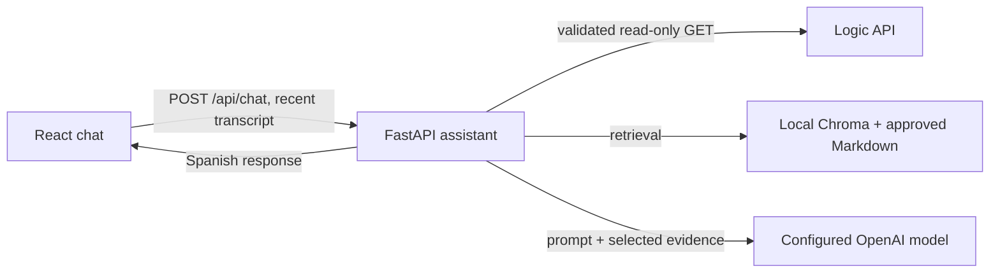

# Phase 7 — Hardening, Security Review and Delivery

## Goal

Prepare the prototype for a defensible PFM delivery and document the gap between prototype and production.

## Security review

Verify:

- no secret committed to git;
- no OpenAI key in frontend;
- no Logic credential in frontend;
- no raw environment dump in logs;
- no unrestricted raw Logic room records sent to LLM;
- no forbidden booking-list routes used;
- outbound timeout configured;
- logs minimize personal data.

## Current Logic API security limitation

Assistant-facing routes currently have no server-to-server authentication.

CORS does not solve this.

Document as a production gap:

- assistant-specific credential;
- least privilege;
- revocation/rotation;
- rate limiting;
- monitoring;
- versioned assistant API contract.

## API contract hardening

Prefer a future family such as:

```text
/api/v1/assistant/...
```

with explicit public DTOs.

This avoids coupling the assistant to database schemas returned by current room/rate endpoints.

## Deployment

Production deployment is optional unless required by the tutor.

If deployed, conceptually keep:

- frontend;
- assistant backend;
- Logic API as external dependency.

Do not add cloud infrastructure only for complexity.

## Performance

Measure actual latency before optimizing.

Do not introduce Redis, queues, autoscaling or CDN logic without evidence.

## Final documentation

Before delivery update:

- README;
- architecture diagram;
- environment variables;
- API dependency list;
- knowledge inventory;
- evaluation instructions;
- limitations;
- production recommendations.

## Final PFM evidence

Preserve:

- repository commit hash used for evaluation;
- final prompt version;
- final knowledge-base version;
- model configuration;
- evaluation result files.

## Future booking phase

Only after the informational assistant is validated should the team consider:

`POST /api/bookings`

Before enabling it, address:

- API authentication;
- consent for personal data;
- data retention;
- `409` handling;
- idempotency;
- timeout uncertainty;
- booking-confirmation UX;
- reservation-code handling.

## Definition of done

The prototype is reproducible, testable, documented and its production limitations are explicit.

## Review completed — 2026-10-18

### Security checks

| Check | Finding | Evidence / action |
|---|---|---|
| Secrets in Git | No `.env` file is tracked. The local `.env` is ignored; `.env.example` contains empty placeholders. | Confirmed with `git ls-files` and `git check-ignore`. Keep real credentials out of fixtures and screenshots. |
| Browser access to Logic/OpenAI | The browser calls only the assistant's `/api/chat` endpoint. Logic API and OpenAI configuration are loaded by the backend. | `frontend/src/App.tsx`, `backend/app/core/config.py`. |
| Room data passed to the model | Room responses pass through an allow-list adapter that drops unapproved fields. | `backend/app/logic_api/adapter.py`. |
| API surface | The Logic client uses the five documented read operations: rates, quote, rooms, opening hours and availability. No booking-list, booking-detail, booking-consult or booking-write operation is used. | `backend/app/logic_api/client.py`; route search across `backend/app`. |
| Network timeouts | Logic requests and OpenAI requests have configurable timeouts. Availability and quotes are not cached. | `backend/app/logic_api/client.py`, `backend/app/core/config.py`, `backend/app/assistant/model.py`. |
| Application logs | Logging configuration does not dump settings, prompts or chat payloads. | `backend/app/core/logging.py`. Evaluation artifacts do store synthetic questions and answers; do not put real customer data in them. |

### Production gaps

- Logic API routes have no server-to-server authentication. The assistant API also has no user authentication, rate limiting or abuse controls. Do not expose this prototype as a public production service without controls at the API and deployment layers.
- CORS is not configured as an access control. A same-origin deployment is assumed; CORS alone would not authenticate callers.
- The current chat flow sends the current message and up to eight preceding messages to the configured model provider. A reservation conversation can include a person's name and phone number. The prototype has no consent flow, retention policy, deletion workflow or privacy notice for this processing. Use synthetic data for evaluation and complete the business/legal data handling review before real customer use.
- API and model vendors process requests under their configured service terms. Select the project, region and retention settings appropriate for the business before deployment.
- The API contract for rooms reflects the existing database schema. The assistant adapter limits exposure, but a versioned public DTO and contract tests on the Logic API remain preferable.
- The health endpoint reports process liveness only; it does not prove that OpenAI, Chroma or Logic API are reachable.
- No production deployment, load test, dependency vulnerability audit or external penetration test is part of this PFM delivery.

### Architecture and data flow



The backend is the only component that calls Logic API and the model provider. The LLM selects among bounded routes; backend code validates arguments and executes the allowed tools. The MVP does not create or confirm bookings.

### Evaluation evidence

The latest preserved 40-case run and its limits are recorded in [`evaluation/results/release_manifest.json`](../evaluation/results/release_manifest.json). The raw records and summary remain in `evaluation/results/`. The automated run reports route/source accuracy and latency; its 40 cases have not received manual faithfulness, relevance or hallucination review, so those metrics remain unmeasured. The manifest distinguishes the historical evaluated run from later working-tree changes and records hash mismatches that prevent claiming the current working tree was that evaluated version.

Before calling a later build an evaluated release, freeze the source, prompt, dataset and knowledge files, run the evaluation against that frozen revision, complete manual review, and preserve the generated summary and raw records with the release manifest.
